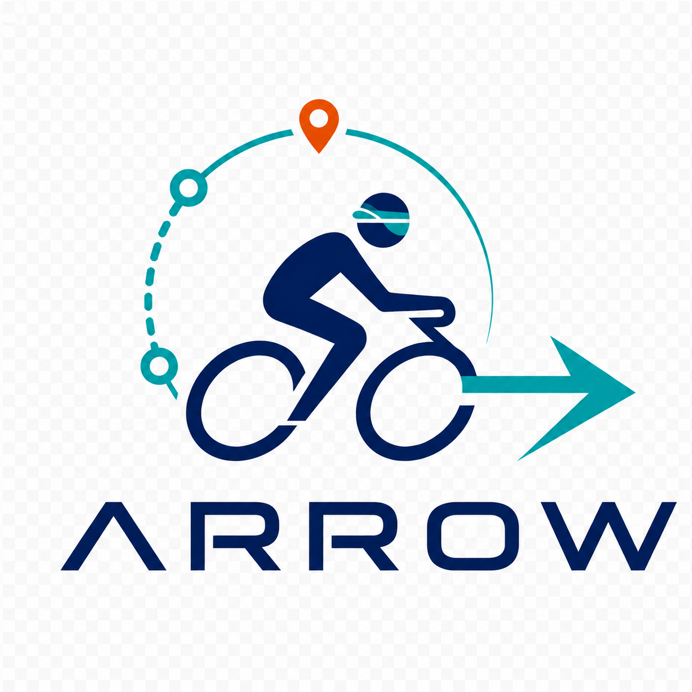
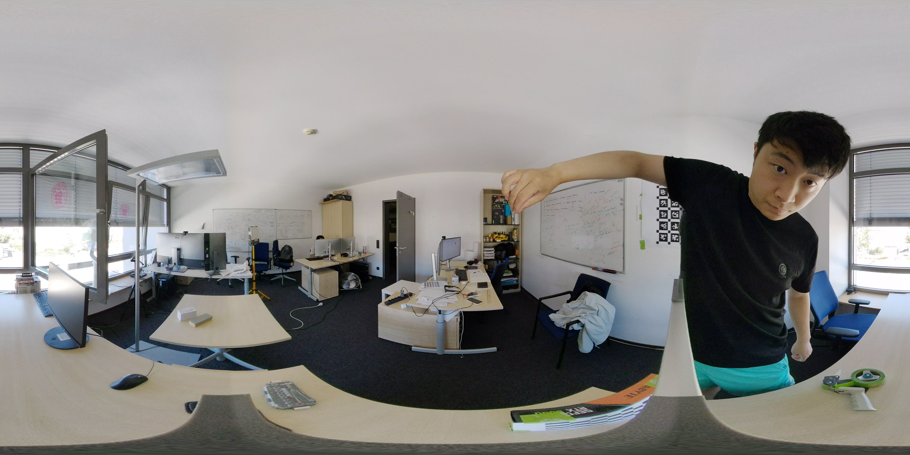
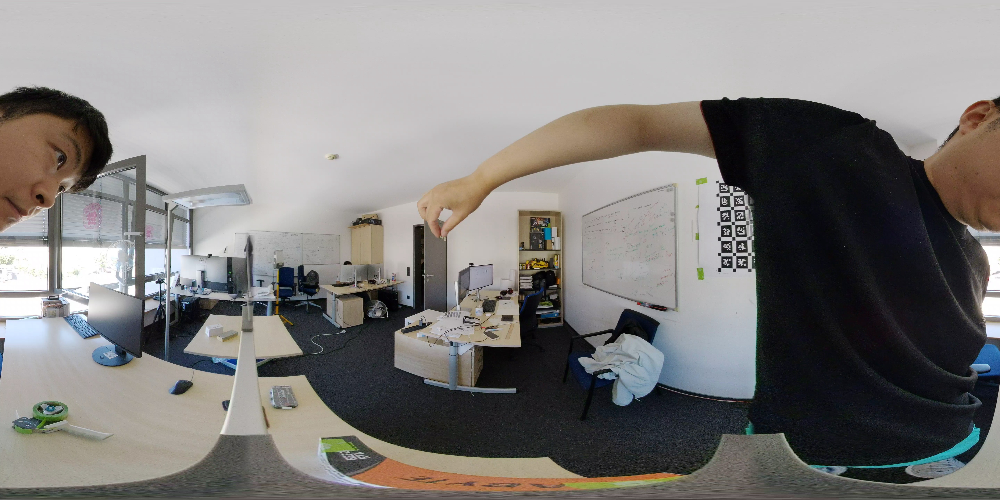
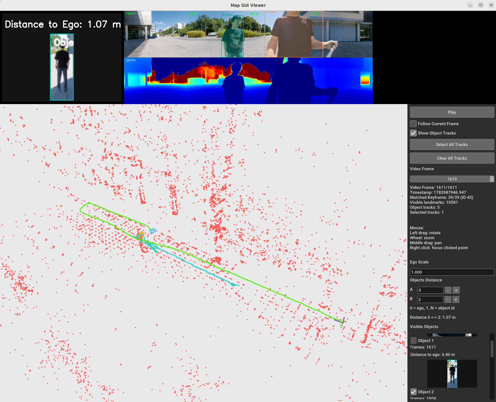

<p align="center">
  
</p>

<h1 align="center">Arrow: 360° Panoramic Perception and Visual SLAM</h1>

Arrow is a perception and visualization pipeline for 360° panoramic video. It combines:

- panoramic visual SLAM with Stella VSLAM;
- multi-view object detection and tracking with Ultralytics YOLO;
- panoramic depth estimation with DAP (Depth Any Panoramas);
- metric map-scale estimation using a calibrated stereo camera pair;
- Open3D visualization of the SLAM map, camera trajectory, and object tracks.

## 🧰 Requirements

- Linux (Ubuntu 22.04 recommended)
- Conda with Python 3.10
- FFmpeg
- Docker
- NVIDIA GPU, NVIDIA driver, and NVIDIA Container Toolkit
- A desktop session with display access for the Stella VSLAM and Open3D viewers

## 📦 Get the Code

```bash
git clone --recursive https://github.com/shaoxiang777/arrow.git
cd arrow
```

The `third_part/DAP` submodule uses a GitHub SSH URL. If the recursive clone fails, configure your GitHub SSH key and run:

```bash
git submodule update --init --recursive
```

## 🐍 Create the Conda Environment

Create an environment named `arrow`:

```bash
conda create -n arrow python=3.10 -y
conda activate arrow
python -m pip install --upgrade pip
pip install -r requirements.txt
```

The root `requirements.txt` is based on the local `arrow` environment and currently uses PyTorch 2.5.1 and torchvision 0.20.1.

### Install DAP dependencies

DAP has an additional requirements file:

```bash
pip install -r third_part/DAP/requirements.txt
```

DAP may install a different PyTorch stack. Verify that PyTorch can access the GPU after installation:

```bash
python -c "import torch; print(torch.__version__); print(torch.cuda.is_available())"
```

Download the [pretrained DAP model](https://huggingface.co/Insta360-Research/DAP-weights/blob/main/model.pth), then place it at:

```text
third_part/DAP/weights/model.pth
```

## 🐳 Build the Stella VSLAM Docker Image

From the repository root, run:

```bash
docker build \
  -t stella_vslam-desktop \
  -f Dockerfile.desktop \
  --build-arg NUM_THREADS="$(nproc)" \
  .
```

Allow the container to access the host display server:

```bash
xhost +SI:localuser:root
```

## 📐 Camera Calibration

`run_cali_opencv.sh` calibrates a synchronized pair of 360° cameras with an OpenCV checkerboard workflow. The process finds the temporal offset, extracts synchronized equirectangular frames, converts them to perspective views, and estimates the stereo calibration.

### 1. Prepare the checkerboard and videos

Print [`stereo_calibration/calib.io_checker_297x210_7x10_25.pdf`](stereo_calibration/calib.io_checker_297x210_7x10_25.pdf) on A4 paper without automatic page scaling. Attach it to a flat, rigid surface and measure the printed square size with a ruler.

The two input videos must already be stitched into standard **equirectangular projection**. Each frame must cover the complete sphere (`360° × 180°`) and normally has a `2:1` width-to-height ratio, for example `4096 × 2048` or `5760 × 2880`.

Do not use camera-native dual-fisheye files or proprietary raw 360° containers directly. For example, a GoPro `.360` file contains separate lens streams and is not itself a standard equirectangular video. First export each recording as a 360° equirectangular MP4 with the camera vendor's stitching software. Use the same projection, resolution, frame rate, and export settings for both cameras; do not export a reframed flat video.


Place the two calibration videos at:

```text
data/ricoh/cali_opencv/
├── cam_0/video.MP4
└── cam_1/video.MP4
```

Activate the project environment:

```bash
conda activate arrow
```

Open `run_cali_opencv.sh` and first update only the video paths and checkerboard parameters. The synchronized start frames are determined in the next step; do not copy `557` and `554` for different recordings.

```bash
CAM0_VIDEO="data/ricoh/cali_opencv/cam_0/video.MP4"
CAM1_VIDEO="data/ricoh/cali_opencv/cam_1/video.MP4"

CHECKERBOARD_ROWS=9
CHECKERBOARD_COLS=6
CHECKERBOARD_SQUARE_SIZE=0.024
```

- `CHECKERBOARD_ROWS` and `CHECKERBOARD_COLS`: OpenCV checkerboard inner-corner dimensions.
- `CHECKERBOARD_SQUARE_SIZE`: measured checkerboard square size in meters.

### 2. Find the synchronization offset

Decode both videos before choosing `CAM0_START_FRAME` and `CAM1_START_FRAME`:

```bash
RUN_EXTRACT_sync=1 RUN_EXTRACT_360=0 bash run_cali_opencv.sh
```

The script decodes both videos into `cam_0/frames` and `cam_1/frames` under `SYNC_ROOT`. Compare the images and identify frame numbers that represent the same moment.

<table>
  <tr>
    <th align="center">cam_0 · frame 000127</th>
    <th align="center">cam_1 · frame 000124</th>
  </tr>
  <tr>
    <td></td>
    <td></td>
  </tr>
</table>

These images show the same moment at frame `127` in `cam_0` and frame `124` in `cam_1`, revealing a fixed offset of three frames:

```text
offset = cam0 frame - cam1 frame = 127 - 124 = 3
```

Verify the offset with several matching moments rather than relying on only one pair. Then inspect the decoded frames and choose a later synchronized pair where the checkerboard calibration sequence begins and the board is sharp and visible in both cameras. For these recordings, frame `557` in `cam_0` was selected; applying the measured offset gives frame `554` in `cam_1`.

The final start frames used by this project are:

```bash
CAM0_START_FRAME=557
CAM1_START_FRAME=554
```

Because `557 - 554 = 3`, the selected start frames preserve the measured offset. The pair `127`/`124` establishes the offset; it does not by itself determine the later start pair `557`/`554`. Recalculate the offset and choose suitable start frames whenever the recordings change.

### 3. Generate synchronized equirectangular pairs

Now update the pairing parameters in `run_cali_opencv.sh`:

```bash
CAM0_START_FRAME=557
CAM1_START_FRAME=554
TIMESTAMP_FPS=30
PAIR_FRAME_STEP=3
PAIRS=300
NUM_PAIRS=50
```

- `CAM0_START_FRAME` and `CAM1_START_FRAME`: a verified synchronized pair near the beginning of the useful calibration sequence.
- `TIMESTAMP_FPS`: actual recording frame rate.
- `PAIR_FRAME_STEP`: interval between sampled frame pairs.
- `PAIRS`: maximum number of synchronized frame pairs to generate.
- `NUM_PAIRS`: number of uniformly selected pairs used for calibration.

Generate the synchronized pairs:

```bash
RUN_EXTRACT_sync=0 RUN_EXTRACT_360=1 bash run_cali_opencv.sh
```

The synchronized frame pairs are written to:

```text
data/ricoh/cali_opencv/sync/paired_<cam0_start>_<cam1_start>/
├── cam0/
├── cam1/
└── pairs.csv
```

Check that images with matching filenames show the same moment and that the checkerboard is sharp and visible in both cameras.

### 4. Run the OpenCV stereo calibration

Run with both extraction stages disabled:

```bash
RUN_EXTRACT_sync=0 RUN_EXTRACT_360=0 bash run_cali_opencv.sh
```

The script selects `NUM_PAIRS` synchronized pairs, converts them to perspective views, detects the checkerboard, and performs stereo calibration. The default output is:

```text
data/ricoh/cali_opencv/virtual_sync_perspective/
├── cam0/
├── cam1/
├── checkerboard_camchain.yaml
└── visualization/
```

`checkerboard_camchain.yaml` contains the perspective-camera intrinsics, distortion parameters, inter-camera transformation, reprojection errors, and stereo baseline. Inspect `visualization/` for incorrect checkerboard detections or reprojections.

The script prints a result similar to:

```text
baseline: 0.263175 m (26.32 cm)
```

Compare this value with the physically measured distance between the two camera centers.


## ⚡ Fast Run

### Download the demo dataset

Download the dataset from the [Team ARROW SharePoint folder](https://dfkide.sharepoint.com/:f:/s/Team_ARROW/IgBujlECowASR78_I0sZ5RGqASkz7HDefUBEumvwgD9k8N0?e=YCNdk1).

Extract or copy the downloaded `data` directory into the repository root. The downloaded dataset has the following layout:

```text
data/
├── arrow360/
│   └── demo/
│       ├── config.yaml
│       ├── video_left_crop.MP4
│       └── video_right_crop.mp4
└── ricoh/
    └── cali_opencv/
        ├── cam_0/
        │   └── video.MP4
        └── cam_1/
            └── video.MP4
```

Make sure the result is `<repository>/data/arrow360/demo/`, not `<repository>/data/data/arrow360/demo/`.

The calibration output `virtual_sync_perspective/checkerboard_camchain.yaml` is generated later by `run_cali_opencv.sh`; it is not included in the downloaded dataset.

## 📁 Scene Data Layout

Each scene used by the complete pipeline requires:

```text
data/arrow360/<scene>/
├── config.yaml
├── video_right_crop.mp4
└── video_left_crop.MP4
```

- `video_right_crop.mp4` is the equirectangular video processed by Stella VSLAM.
- `video_left_crop.MP4` is the synchronized video from the other calibrated camera and is used to estimate the metric map scale.
- `config.yaml` is the Stella VSLAM camera configuration.

### Understanding `mask_rectangles` in `config.yaml`

`mask_rectangles` prevents Stella VSLAM from extracting ORB features in image regions that are unreliable or irrelevant, such as the camera rig, the operator, a vehicle body, or a stitching seam. It does not crop or modify the video.

Each rectangle uses normalized image coordinates in the following order:

```text
[x_min, x_max, y_min, y_max]
```

The coordinate origin is the top-left corner. Both axes use the range `0.0` to `1.0`, where `x` is measured across the image width and `y` across the image height.

For example:

```yaml
mask_rectangles:
  - [0.0, 0.25, 0.0, 1.0]
  - [0.9, 1.0, 0.0, 1.0]
  - [0.0, 1.0, 0.8, 1.0]
```

These rectangles mask:

- the leftmost 25% of the image over its full height;
- the rightmost 10% of the image over its full height;
- the bottom 20% of the image over its full width.

For a `5760 × 2880` video, these correspond approximately to `x=0–1440`, `x=5184–5760`, and `y=2304–2880`. Adjust the rectangles for each camera setup. Masking too much of the image reduces the number of usable features and can make SLAM initialization or tracking unstable.

The stereo calibration must be available at:

```text
data/ricoh/cali_opencv/virtual_sync_perspective/checkerboard_camchain.yaml
```

### Run the complete pipeline

After installing the dependencies, building the Docker image, calibrating the stereo cameras, and preparing the scene data, run the complete pipeline with:

```bash
conda activate arrow
bash run_slam.sh demo
```

Replace `demo` with another scene directory name when needed. The script automatically downloads the ORB vocabulary if it is missing and reuses completed outputs when possible.

The complete pipeline is:

```text
Stella VSLAM
    ↓
my_saved_map.msg + frame_trajectory.txt
    ↓
estimate_stereo_map_scale.py
    ↓
my_saved_map_metric.msg + frame_trajectory_metric.txt
    ↓
DAP depth inference + object detection and tracking
```

The main generated files are:

```text
data/arrow360/<scene>/
├── frame_trajectory.txt
├── my_saved_map.msg
├── frame_trajectory_metric.txt
├── my_saved_map_metric.msg
├── stereo_map_scale_keyframes.csv
├── stereo_map_scale.yaml
├── stereo_map_scale_visualization/
└── object_tracks.json

output/arrow360/<scene>/
└── video_right_crop_object_detection.mp4
```

Visualize the metric map and object tracks

```bash
python visualize_map_gui.py \
  --map data/arrow360/demo/my_saved_map_metric.msg \
  --fps 30 \
  --tracks-json data/arrow360/demo/object_tracks.json \
  --frame-traj data/arrow360/demo/frame_trajectory_metric.txt \
  --slam-frame-skip 2 \
  --overlay-video output/arrow360/demo/video_right_crop_object_detection.mp4
```

<p align="center">
  
</p>


## 🧭 Manual Pipeline

Use this section when you want to run or debug each stage separately.

### 1. Run Stella VSLAM

Download the ORB vocabulary if it is not already present:

```bash
curl -fL \
  https://github.com/stella-cv/FBoW_orb_vocab/raw/main/orb_vocab.fbow \
  -o orb_vocab.fbow
```

Run Stella VSLAM for the `demo` scene:

```bash
docker run --rm --privileged \
  -e DISPLAY="$DISPLAY" \
  -v /tmp/.X11-unix:/tmp/.X11-unix:ro \
  -v "$PWD:/work" \
  --gpus all \
  stella_vslam-desktop \
  -lc 'cd /stella_vslam_examples/build && ./run_video_slam \
    -v /work/orb_vocab.fbow \
    -c /work/data/arrow360/demo/config.yaml \
    -m /work/data/arrow360/demo/video_right_crop.mp4 \
    --frame-skip 2 \
    --no-sleep \
    --eval-log-dir /work/data/arrow360/demo/ \
    --map-db-out /work/data/arrow360/demo/my_saved_map.msg'
```

This stage generates `my_saved_map.msg` and `frame_trajectory.txt`.

### 2. Estimate the metric map scale

```bash
python tools/estimate_stereo_map_scale.py demo \
  --slam-video data/arrow360/demo/video_right_crop.mp4 \
  --slam-camera cam1 \
  --calibration data/ricoh/cali_opencv/virtual_sync_perspective/checkerboard_camchain.yaml \
  --other-video data/arrow360/demo/video_left_crop.MP4
```

This stage generates `my_saved_map_metric.msg`, `frame_trajectory_metric.txt`, and scale diagnostics.

### 3. Run DAP depth inference and object tracking

```bash
conda activate arrow

python tools/equirec2perspec_video.py \
  --video data/arrow360/demo/video_right_crop.mp4 \
  --output output/arrow360/demo \
  --track-output data/arrow360/demo/object_tracks.json \
  --map-path data/arrow360/demo/my_saved_map_metric.msg \
  --frame-traj-path data/arrow360/demo/frame_trajectory_metric.txt \
  --slam-frame-skip 2 \
  --depth-model dap \
  --frame_skip 10 \
  --adaptive-dap \
  --kalman_filter \
  --track-max-speed 3.0 \
  --max_depth 100
```


## 🙏 Acknowledgements and License

Arrow builds on [Stella VSLAM](https://github.com/stella-cv/stella_vslam), DAP, Ultralytics YOLO, Open3D, and other open-source projects. See [LICENSE](LICENSE) and the license files in each submodule for details.
